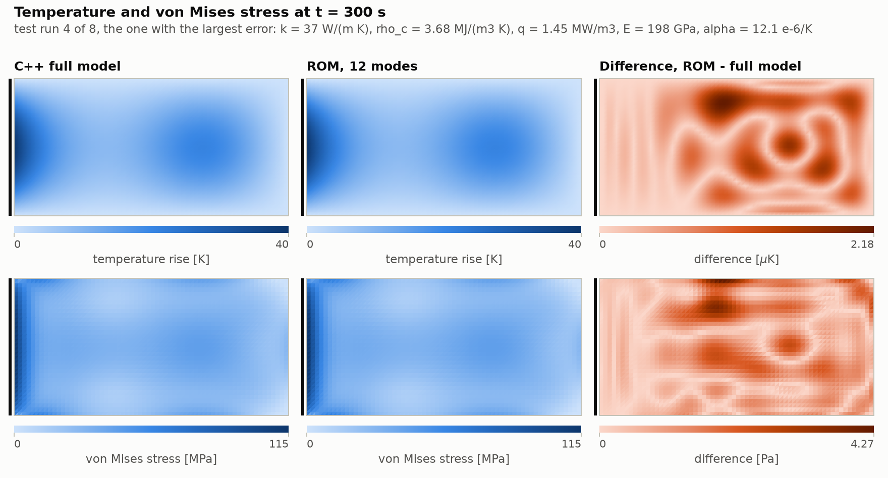
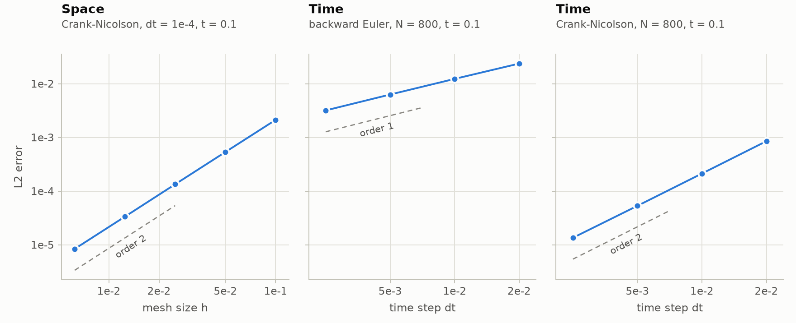
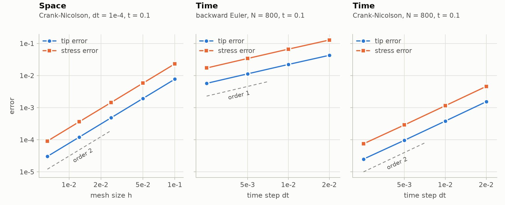
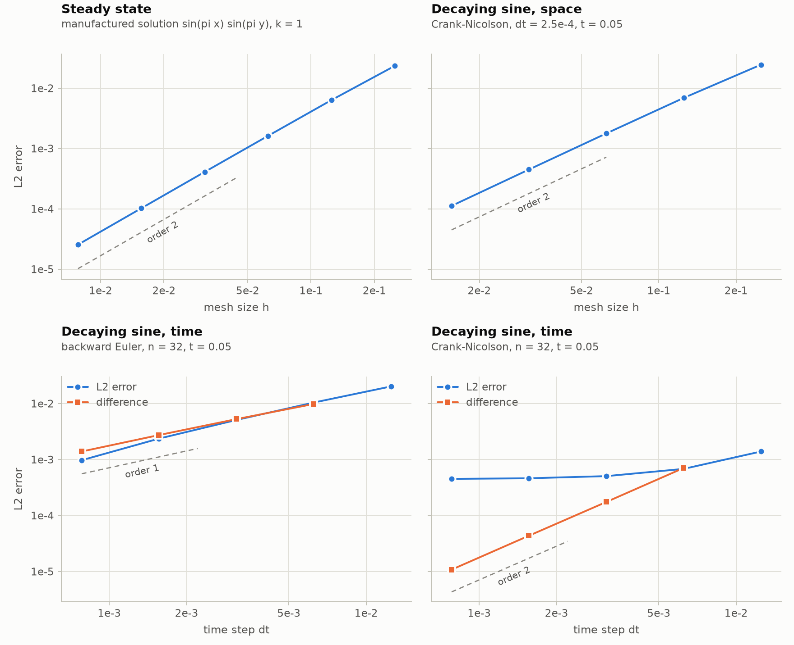
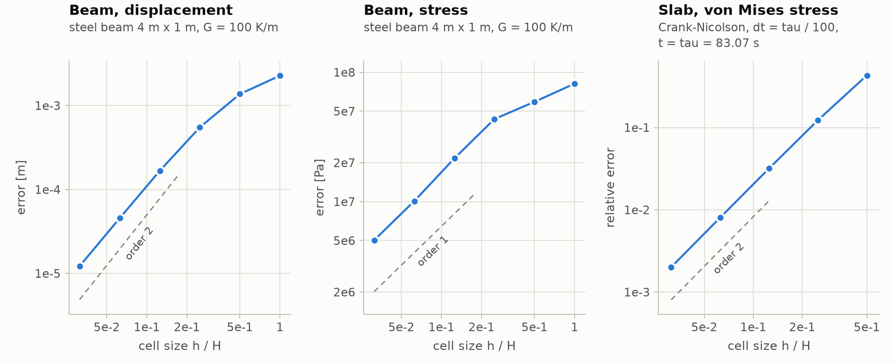
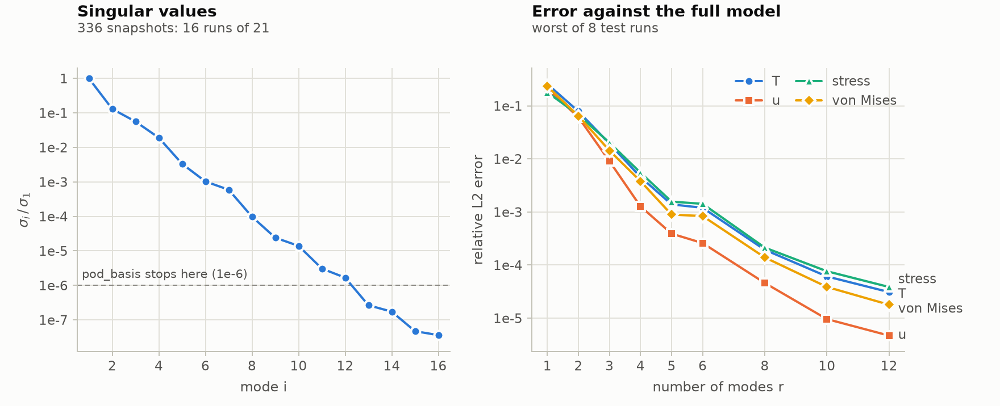
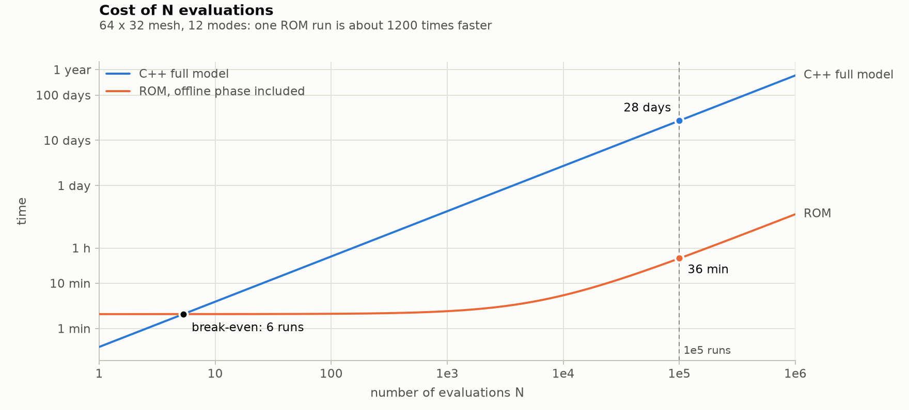
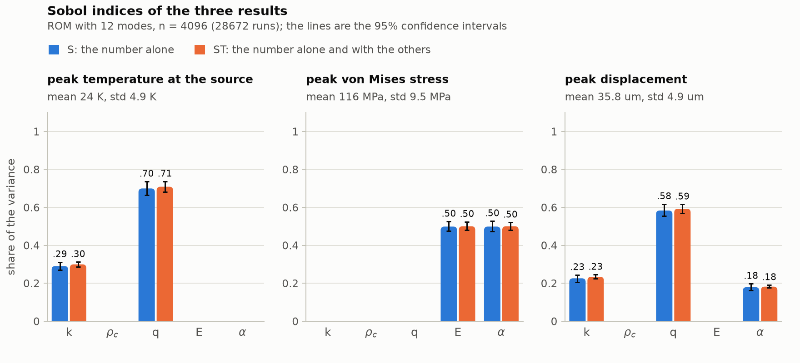
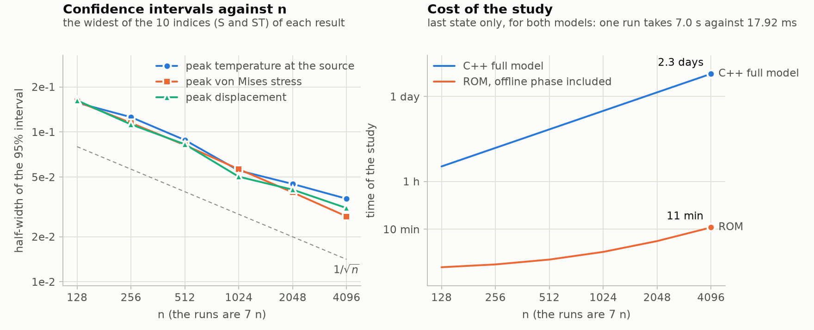

# Thermomechanical-Twin

[](https://github.com/VsevolodOzmitelVolpato/Thermomechanical-Twin/actions/workflows/ci.yml)
[](LICENSE)


A thermo-mechanical *digital twin* of a heated component: a C++ finite-element core, with a Python reduced-order model and a Sobol sensitivity analysis on top. The goal is a small simulation stack in which every layer is checked against hand calculations, exact solutions and measured convergence orders before the next layer is built.

**Status: the planned scope is complete.** The C++ core works in 1D and in 2D and is verified (see [Verification](#verification)): heat conduction, thermal expansion and thermal stress, the whole chain temperature -> displacement -> stress, and in 2D the von Mises stress. On top of it, a Python layer provides a reduced-order model of the 2D plate (see [Reduced-order model](#reduced-order-model)) and a Sobol sensitivity analysis of that model (see [Uncertainty quantification](#uncertainty-quantification)). What the project deliberately leaves out is listed in [Known limitations](#known-limitations).

**Contents:** [Highlights](#highlights) | [What works today](#what-works-today) | [Build and test](#build-and-test) | [Examples](#examples) | [Verification](#verification) | [Convergence studies](#convergence-studies) | [Reduced-order model](#reduced-order-model) | [Uncertainty quantification](#uncertainty-quantification) | [Design notes](#design-notes) | [Known limitations](#known-limitations) | [License](#license)

## Highlights

- **A finite-element core written from scratch in C++17**, using only the standard library: CSR sparse matrices, conjugate gradient with a Jacobi preconditioner, linear elements in 1D and on triangles in 2D, theta-scheme time stepping, plane-strain thermo-elasticity and the von Mises stress.
- **Checked at three levels:** hand calculations, exact solutions and measured convergence orders (see [Verification](#verification) and [Convergence studies](#convergence-studies)), with over 300 C++ tests (GoogleTest) and over 2000 Python test cases (pytest).
- **A reduced-order model of the 2D plate** (proper orthogonal decomposition and Galerkin projection). With 12 modes it reproduces the full model to better than 4e-5 in relative L2 error (worst of 8 test runs), and one evaluation takes 3.8 to 4.6 ms instead of 1.7 s: 370 to 440 times less than this project's own C++ full model (see [What the speed-up means](#what-the-speed-up-means)).
- **A Sobol sensitivity analysis on the reduced model:** 28672 evaluations in 58 seconds, where the full model would take about 3.8 hours (estimated from the time of one run). The peak temperature at the source depends mostly on the heat source (70 % of the variance) and the conductivity (29 %); the peak von Mises stress on Young's modulus and the expansion coefficient (50 % each).

<p align="center">
  <picture>
    <source media="(prefers-color-scheme: dark)" srcset="docs/figures/rom_fields_dark.png">
    
  </picture>
</p>

*The full C++ model and the reduced-order model with 12 modes for the test run with the largest error, and their difference (see [Reduced-order model](#reduced-order-model)).*

## What works today

- Sparse matrices in CSR format, Conjugate Gradient (CG) and Jacobi-preconditioned CG.
- Dirichlet conditions by symmetric elimination, so the system matrix stays symmetric and CG applies (in 1D and in 2D).
- Failures are reported, not hidden: `CGSolver` exposes `has_converged()`, and the heat and thermal-expansion solvers throw `std::runtime_error` when the linear solver does not converge (for example with NaN in the data) and `std::invalid_argument` when the data are inconsistent (wrong sizes, non-positive coefficients, nodes that do not exist, ...).
- Over 300 C++ unit tests (GoogleTest) and over 2000 Python test cases (pytest), a program that prints the convergence tables below, and Python scripts that draw the figures and run the benchmarks.

**In 1D**

- Linear (P1) finite elements for `rho_c dT/dt - k d2T/dx2 = q`: stiffness, consistent mass and load assembly.
- Steady-state solver, and time stepping with the theta scheme (`theta = 1`: backward Euler, `theta = 0.5`: Crank-Nicolson):

  `(M + theta dt K) T_new = (M - (1 - theta) dt K) T_old + dt F`
- Thermal expansion and thermal stress (linear elasticity, `sigma = E (u' - alpha (T - T_ref))`): equivalent thermal nodal forces, the displacement of a bar clamped at the left end and free or clamped at the right end, and the stress in every element.
- The whole chain in one call: `solve_thermomechanical(problem)` runs the transient heat solver, gives its final temperature to the expansion solver, and returns temperature, displacement and stress.

**In 2D**

- Triangle meshes: `Mesh2D` checks its data once (existing nodes, counter-clockwise triangles with positive area), `rectangle_mesh` builds structured meshes and `boundary_nodes` finds the boundary.
- Heat conduction with P1 triangles: element stiffness, consistent mass and load (uniform or varying source), sparse assembly from (row, column, value) triplets, a steady-state solver `solve_steady_2d` and theta-scheme time stepping `solve_transient_2d`, which builds its matrices once, before the time loop.
- Thermo-elasticity in plane strain: the elasticity matrix, the strain-displacement matrix of a triangle, element stiffness and thermal load, assembly, the displacement solver `solve_displacement_2d`, and the stress of every triangle, `sigma = D (B u - eps_th)`.
- The whole chain in one call: `solve_thermomechanical_2d(mesh, problem)` marches the temperature in time and returns, at the steps you ask to keep, temperature, displacement and stress.
- The von Mises equivalent stress of every triangle, including the out-of-plane stress of plane strain: `von_mises_field_2d`.

In both cases the coupling is one-way: heat deforms the body, the deformation does not heat it.

**In Python**

- `thermomech`, a [pybind11](https://github.com/pybind/pybind11) module that exposes the 2D solvers of the C++ core as Python functions on NumPy and SciPy objects: meshes, the assembled matrices, steady and transient heat conduction, and the whole thermo-mechanical chain.
- The `twin` package, built on it: a proper-orthogonal-decomposition basis computed from snapshots (`pod_basis`), the Galerkin projection of the heat equation (`solve_reduced_heat`), the reduced-order model of the whole thermo-mechanical problem (`ThermoMechanicalROM`), and Sobol sensitivity indices with bootstrap confidence intervals (`sobol_indices`).

## Build and test

Requirements: CMake 3.20 or newer, a C++17 compiler, and Python 3 with the packages of `requirements.txt` (NumPy, SciPy, Matplotlib, pytest; on Linux the Python development headers too, `python3-dev` on Debian and Ubuntu). Developed with GCC 14 (MinGW-w64, Windows) and Python 3.14; it also builds and passes all tests with GCC 13 on Linux, and a GitHub Actions workflow (`.github/workflows/ci.yml`) repeats the build and the tests on Linux with Python 3.13 and 3.14 at every push (the Windows build is checked by hand). GoogleTest and pybind11 are downloaded by CMake the first time you configure, so an internet connection is needed once.

```
git clone https://github.com/VsevolodOzmitelVolpato/Thermomechanical-Twin.git
cd Thermomechanical-Twin

pip install -r requirements.txt
cmake -S . -B build -G Ninja
cmake --build build
ctest --test-dir build --output-on-failure
```

`-G Ninja` is optional; any CMake generator works. The default build type is Release (the C++ model is about 15 times slower without optimisation); pass `-DCMAKE_BUILD_TYPE=...` when you configure to change it. `ctest` runs the C++ unit tests and the Python tests (`python/tests`, one CTest test called `python_tests`). The C++ core does not need Python: configure with `-DTWIN_BUILD_PYTHON=OFF` to skip the module and its tests.

To reproduce the tables below, run `./build/convergence_study` (`.\build\convergence_study.exe` on Windows). To redraw the figures from it, run `python scripts/plot_convergence.py` from the project folder (it writes into `docs/figures/`). The reduced-order model and the sensitivity analysis have their own scripts, described in their sections.

## Examples

### 1D: a steel bar

A steel bar 1 m long. One end is held at 20 degrees C and the other at 120 degrees C; initially everything is at 20 degrees C except the hot end. After 100 000 s (about twelve of the slowest thermal time constants) the temperature is practically the steady linear profile, so the results can be checked by hand: the mean temperature rise is 50 K.

```cpp
#include "Thermoelastic1D.h"

ThermoMechanicalProblem p;
p.x = uniform_mesh(1.0, 100);          // 100 elements, 1 m
p.rho_c = 3.8e6;                       // density * specific heat [J/(m3 K)]
p.k = 45.0;                            // conductivity [W/(m K)]
p.q = 0.0;                             // no heat source
p.T_left = 20.0;                       // temperatures of the two ends
p.T_right = 120.0;
p.T0 = DVector(p.x.size(), 20.0);      // initial temperature, one value per node
p.T0.back() = p.T_right;
p.dt = 1000.0;                         // 100 steps of 1000 s
p.n_steps = 100;
p.theta = 1.0;                         // backward Euler
p.E = 200e9;                           // Young modulus [Pa]
p.alpha = 12e-6;                       // thermal expansion [1/K]
p.T_ref = 20.0;                        // temperature at which the bar has no stress

p.right_end = RightEnd::Fixed;         // or RightEnd::Free
ThermoMechanicalResult r = solve_thermomechanical(p);
// r.T[i]: temperature [deg C], r.u[i]: displacement [m], r.sigma[e]: stress [Pa] (one per element)
```

With `RightEnd::Free` the tip moves by 0.6000 mm (`alpha * 50 K * 1 m`) and the stress is zero up to round-off. With `RightEnd::Fixed` the bar cannot expand and the stress is -120.0 MPa in every element (`-E * alpha * 50 K`), i.e. compression.

### 2D: a steel slab that cools

A steel slab 0.1 m thick and 0.4 m long, hot in the middle (100 K above `T_ref`, with a sine profile across the thickness) and with both faces held at `T_ref`. The two ends are on rollers: they cannot move along x. The program lets it cool for one time constant `tau = H^2 rho c / (pi^2 k)`, about 83 s, and reports the von Mises stress.

```cpp
#include <algorithm>
#include <cmath>
#include <iostream>

#include "Elasticity2D.h"
#include "Mesh2D.h"
#include "Thermoelastic2D.h"

int main() {
    const double pi = std::acos(-1.0);
    const double H = 0.1;                                   // thickness of the slab [m]
    const std::size_t k = 16;                               // cells across the thickness
    const Mesh2D mesh = rectangle_mesh(4 * H, H, 4 * k, k); // the slab is 4 H long

    ThermoMechanicalProblem2D p;
    p.rho_c = 7850.0 * 470.0;                               // density * specific heat [J/(m3 K)]
    p.k = 45.0;                                             // conductivity [W/(m K)]
    p.E = 210e9;                                            // Young modulus [Pa]
    p.nu = 0.3;                                             // Poisson ratio
    p.alpha = 12e-6;                                        // thermal expansion [1/K]
    p.T_ref = 293.15;                                       // stress-free temperature [K]
    p.f = DVector(mesh.num_nodes(), 0.0);                   // no heat source
    p.T0 = DVector(mesh.num_nodes());

    for (std::size_t n = 0; n < mesh.num_nodes(); ++n) {
        const double x = mesh.x(n), y = mesh.y(n);
        p.T0[n] = p.T_ref + 100.0 * std::sin(pi * y / H);   // hot in the middle, T_ref on the two faces
        if (y < 1e-12 || y > H - 1e-12) {                   // the faces are held at T_ref
            p.fixed_nodes.push_back(n);
            p.fixed_temperatures.push_back(p.T_ref);
        }
        if (x < 1e-12 || x > 4 * H - 1e-12) {               // rollers at both ends: no displacement in x
            p.fixed_dofs.push_back(2 * n);
            p.fixed_displacements.push_back(0.0);
        }
    }
    p.fixed_dofs.push_back(1);                              // and no rigid motion in y (node 0)
    p.fixed_displacements.push_back(0.0);

    const double tau = H * H * p.rho_c / (pi * pi * p.k);   // time constant of the temperature, 83.07 s
    p.dt = tau / 100.0;
    p.n_steps = 100;                                        // march until t = tau ...
    p.save_every = 100;                                     // ... and keep only the first and the last state
    p.theta = 0.5;                                          // Crank-Nicolson

    const auto states = solve_thermomechanical_2d(mesh, p);
    const ThermoMechanicalState2D& last = states.back();    // last.T, last.u (2 numbers per node), last.sigma
    const auto vm = von_mises_field_2d(mesh, last.sigma, p.E, p.nu, p.alpha, last.T, p.T_ref);

    std::cout << "t = " << last.time << " s, largest von Mises stress = "
              << *std::max_element(vm.begin(), vm.end()) / 1e6 << " MPa\n";
    std::cout << "textbook value at mid-height: "
              << p.E * p.alpha * 100.0 * std::exp(-1.0) / (1.0 - p.nu) / 1e6 << " MPa\n";
}
```

```
t = 83.0721 s, largest von Mises stress = 130.925 MPa
textbook value at mid-height: 132.437 MPa
```

The textbook value comes from a simple argument. The slab is long, so away from the ends it can expand neither along x (rollers) nor along z (plane strain): the thermal expansion in those two directions is completely held back, `sigma_xx = sigma_zz = -E alpha dT / (1 - nu)` and `sigma_yy = 0`, and the von Mises stress is `E alpha dT / (1 - nu)`. At mid-height `dT = 100 K / e` after one time constant. The mesh has 16 cells across the thickness; the slab table below shows the error falling by a factor 4 each time the cells are halved.

## Verification

How do we know the solver is right? Three kinds of evidence, from simple to demanding.

1. **Hand calculations.** Tiny meshes whose results can be written on paper.
   - In 1D: stiffness, load, mass, Dirichlet elimination, the L2 error and the observed order, thermal forces, displacements and stresses of bars with a few elements, and a complete one-step heat -> expansion -> stress example.
   - In 2D: stiffness, mass and load of single triangles and of two square cells, Dirichlet elimination, the elasticity matrix, the strain-displacement matrix, stiffness and thermal load of a triangle, small elasticity problems on the unit square, and the von Mises stress of simple states.
2. **Exact solutions.**
   - Steady state with constant `k` and `q`: `T(x) = T_left + (T_right - T_left) x / L + q x (L - x) / (2k)`. For this problem linear elements give the exact nodal values on any mesh, including graded ones, so the tests use a tolerance of 1e-9.
   - Time stepping: on a uniform mesh, `sin(pi x / L)` is an eigenvector of both `K` and `M`, so the theta scheme multiplies it by a known factor `g` at every step. This gives the exact solution of the *discrete scheme* (not of the PDE), and the tests compare the solver with `g^n sin(pi x / L)` to within 1e-9, for three values of `theta`.
   - Properties: the stationary solution is a fixed point of the scheme, any initial condition relaxes to it, the mass matrix sums to the total heat capacity.
   - Thermal stress in 1D: a bar heated by the same `dT` everywhere and clamped at both ends has the uniform stress `-E alpha dT` (240 MPa of compression for steel heated by 100 K); with a free end the stress is zero. A free bar has zero stress for *any* temperature field on *any* mesh. A linear temperature on a graded mesh gives the clamped bar a uniform stress, equal to `-E alpha` times the mean temperature rise.
   - Linear fields in 2D are reproduced exactly on irregular meshes: a linear temperature by the heat solver, a linear displacement field by the elasticity solver. A linear displacement field has the same strain and the same stress in every triangle, and the code gives exactly that. Rigid motions produce no force, and the strain energy of linear fields is exact.
   - Thermal stress in 2D: a free plate that is heated uniformly expands by `(1 + nu) alpha dT` in every direction of the plane with zero stress, and the same plate clamped on all sides is compressed equally in all directions (its von Mises stress is zero). A plate heated between two walls, a rectangle in uniaxial tension and a cooling steel slab match their textbook formulas.
   - Heat in 2D: an insulated plate conserves its heat, the fixed nodes remove exactly the heat that is produced, implicit schemes never gain energy (the explicit one blows up), and on a mesh of 2 x 2 cells the decaying-sine error has a closed form that the solver reproduces for every scheme.
   - Cross-checks: the sparse assembly of every matrix is compared with a slow dense assembly, and the solvers with dense solutions, on several kinds of mesh (a rectangle, a triangle with a node inside, an irregular quadrilateral, triangles of different areas, a mesh with nodes that belong to no triangle).
3. **Convergence orders** (below). The cheaper rows of the 2D plate and beam tables are also pinned by unit tests with a relative tolerance of 1e-6, so a change in the numerics that alters those numbers fails a test instead of silently invalidating this page.

## Convergence studies

`apps/convergence_study.cpp` prints every table below, and `scripts/plot_convergence.py` draws the figures from the same output.

**Observed order.** If the error behaves like `C h^p`, then `p = ln(e_coarse / e_fine) / ln(ratio)`, where `ratio` is the refinement factor (here always 2). The tables print `p` in the `order` columns; a first row has none (`-`) because it has no coarser row to compare with.

**Figures.** Each panel shows the numbers of one table (or one quantity of it, when a table mixes units) on log-log axes: an error of order `p` is a straight line of slope `p`. The dashed line is the slope the method is supposed to have (order 1 or 2). It is drawn a little below the finest points, and only over the finest steps, so that it neither hides the data nor crosses the coarse points, which are often not on the line yet; data running parallel to it converge at that order.

### 1D heat conduction

Test problem: a bar of length 1, `k = 1`, `rho_c = 1`, no source, both ends held at 0, initial temperature `sin(pi x)`. The exact solution is `T(x, t) = exp(-pi^2 t) sin(pi x)`.

- **Error:** the L2 norm of the difference between the numerical and the exact nodal values at `t = 0.1`. Because both fields are piecewise linear, it is computed as `sqrt(e^T M e)`, with `M` the mass matrix for `rho_c = 1`.
- **Separating the two error sources:** the total error is a mesh error plus a time error. The spatial study uses a tiny time step so that the time error is negligible. The temporal studies use a fine mesh (`N = 800`) so that the mesh error (about 3.5e-7) is far below the time error.

#### Spatial convergence (Crank-Nicolson, dt = 1e-4, t = 0.1)

|     N |        h | L2 error | order |
|------:|---------:|---------:|------:|
|    10 | 1.00e-01 | 2.12e-03 |     - |
|    20 | 5.00e-02 | 5.34e-04 |  1.99 |
|    40 | 2.50e-02 | 1.34e-04 |  2.00 |
|    80 | 1.25e-02 | 3.34e-05 |  2.00 |
|   160 | 6.25e-03 | 8.38e-06 |  2.00 |

#### Temporal convergence (backward Euler, N = 800, t = 0.1)

| steps |       dt | L2 error | order |
|------:|---------:|---------:|------:|
|     5 | 2.00e-02 | 2.37e-02 |     - |
|    10 | 1.00e-02 | 1.23e-02 |  0.94 |
|    20 | 5.00e-03 | 6.29e-03 |  0.97 |
|    40 | 2.50e-03 | 3.18e-03 |  0.99 |

#### Temporal convergence (Crank-Nicolson, N = 800, t = 0.1)

| steps |       dt | L2 error | order |
|------:|---------:|---------:|------:|
|     5 | 2.00e-02 | 8.49e-04 |     - |
|    10 | 1.00e-02 | 2.12e-04 |  2.00 |
|    20 | 5.00e-03 | 5.31e-05 |  1.99 |
|    40 | 2.50e-03 | 1.35e-05 |  1.97 |

<p align="center">
  <picture>
    <source media="(prefers-color-scheme: dark)" srcset="docs/figures/convergence_heat_1d_dark.png">
    
  </picture>
</p>

**Reading the tables.**
- Linear elements are second order in space: halving `h` divides the error by 4.
- Backward Euler is first order in time. The observed order approaches 1 from below as `dt` decreases (0.94, 0.97, 0.99): an order is a statement about the limit `dt -> 0`.
- Crank-Nicolson is second order in time. The small drop at the finest `dt` (1.97) is the mesh error starting to show next to a very small time error, not a loss of accuracy of the scheme: on a finer mesh (`N = 1600`) the three orders are 2.00, 2.00 and 1.99.

### 1D thermo-mechanical chain

The same decaying-sine problem, followed through the whole chain: temperature, then expansion, then stress. With `T_ref = 0`, `E = 3` and `alpha = 2` the chain has two exact results at time `t`:

- Bar with a free right end: the tip moves by `alpha` times the integral of `T`, that is `2 alpha exp(-pi^2 t) / pi`.
- Bar clamped at both ends: the stress is the same in every element, `-E alpha` times the mean of `T`, that is `-2 E alpha exp(-pi^2 t) / pi`.

The tables report the absolute error of the tip displacement (free bar) and the largest absolute error of the stress over the elements (clamped bar) at `t = 0.1`. The observed order is computed on the tip error. The spatial and temporal setups are the same as above.

#### Chain: spatial convergence (Crank-Nicolson, dt = 1e-4, t = 0.1)

|     N |        h | tip error | order | stress error |
|------:|---------:|----------:|------:|-------------:|
|    10 | 1.00e-01 |  7.73e-03 |     - |     2.32e-02 |
|    20 | 5.00e-02 |  1.94e-03 |  2.00 |     5.81e-03 |
|    40 | 2.50e-02 |  4.85e-04 |  2.00 |     1.45e-03 |
|    80 | 1.25e-02 |  1.21e-04 |  2.00 |     3.64e-04 |
|   160 | 6.25e-03 |  3.03e-05 |  2.00 |     9.10e-05 |

#### Chain: temporal convergence (backward Euler, N = 800, t = 0.1)

| steps |       dt | tip error | order | stress error |
|------:|---------:|----------:|------:|-------------:|
|     5 | 2.00e-02 |  4.27e-02 |     - |     1.28e-01 |
|    10 | 1.00e-02 |  2.22e-02 |  0.94 |     6.66e-02 |
|    20 | 5.00e-03 |  1.13e-02 |  0.97 |     3.40e-02 |
|    40 | 2.50e-03 |  5.72e-03 |  0.99 |     1.72e-02 |

#### Chain: temporal convergence (Crank-Nicolson, N = 800, t = 0.1)

| steps |       dt | tip error | order | stress error |
|------:|---------:|----------:|------:|-------------:|
|     5 | 2.00e-02 |  1.53e-03 |     - |     4.59e-03 |
|    10 | 1.00e-02 |  3.82e-04 |  2.00 |     1.15e-03 |
|    20 | 5.00e-03 |  9.63e-05 |  1.99 |     2.89e-04 |
|    40 | 2.50e-03 |  2.50e-05 |  1.95 |     7.49e-05 |

<p align="center">
  <picture>
    <source media="(prefers-color-scheme: dark)" srcset="docs/figures/convergence_chain_1d_dark.png">
    
  </picture>
</p>

**Reading the tables.**
- Displacement and stress inherit the orders of the temperature they come from: second order in space, first order in time for backward Euler (0.94, 0.97, 0.99, as above) and second order in time for Crank-Nicolson. The 1.95 in the last row is again the mesh error showing next to a very small time error (with `N = 1600` the three orders are 2.00, 2.00 and 1.99).
- The stress error is `E / L = 3` times the tip error in every row (up to the printed digits). In the discrete problem, the equilibrium of the clamped bar forces a uniform stress equal to `-(E / L)` times the tip displacement of the free bar. The two columns come from two different solves, free and clamped, so the constant ratio is a free consistency check of the mechanics.

### 2D heat conduction

Two problems on the unit square, with `k = 1` and the temperature held at 0 on the whole boundary, on meshes of `n x n` cells, each split into two triangles (`h = 1/n`). The error is the L2 norm of the difference between the numerical and the exact nodal values, computed as in 1D.

- **Manufactured steady solution:** the source `q = 2 pi^2 k sin(pi x) sin(pi y)` has the exact solution `T = sin(pi x) sin(pi y)`, whatever `k`. The load is integrated with the midpoint rule on the edges of each triangle, and the system is solved with CG.
- **Decaying sine:** `rho_c = 1`, no source, initial temperature `sin(pi x) sin(pi y)`. The exact solution is `T = exp(-2 pi^2 t) sin(pi x) sin(pi y)`, compared at `t = 0.05`.

#### 2D plate: manufactured solution sin(pi x) sin(pi y) (k = 1)

|     n |        h | L2 error | order |
|------:|---------:|---------:|------:|
|     4 | 2.50e-01 | 2.34e-02 |     - |
|     8 | 1.25e-01 | 6.34e-03 |  1.89 |
|    16 | 6.25e-02 | 1.62e-03 |  1.97 |
|    32 | 3.12e-02 | 4.08e-04 |  1.99 |
|    64 | 1.56e-02 | 1.02e-04 |  2.00 |
|   128 | 7.81e-03 | 2.55e-05 |  2.00 |

#### 2D plate: decaying sine, spatial convergence (Crank-Nicolson, dt = 2.5e-4, t = 0.05)

|     n |        h | L2 error | order |
|------:|---------:|---------:|------:|
|     4 | 2.50e-01 | 2.45e-02 |     - |
|     8 | 1.25e-01 | 6.89e-03 |  1.83 |
|    16 | 6.25e-02 | 1.78e-03 |  1.96 |
|    32 | 3.12e-02 | 4.48e-04 |  1.99 |
|    64 | 1.56e-02 | 1.12e-04 |  1.99 |

In 1D the temporal studies used a mesh so fine that its error did not matter. In 2D that would mean too many unknowns, so the time tables use `n = 32` and the mesh error, about 4.5e-4 (the `n = 32` row of the spatial table), stays inside the L2 error. It does not depend on `dt`, so the ratio of two consecutive errors is *not* the order. These tables have an extra column, the difference between the error of the row above and the error of the row: the mesh error cancels in it, and the order is computed from the ratio of two consecutive differences. A row has no difference until it has a row above it, and no order until it has a difference above it. A difference of errors isolates the time error only while the error keeps its sign. The backward Euler error changes sign between 128 and 256 steps, where its shrinking time error falls below the mesh error, which has the opposite sign; the backward Euler table stops at 64 steps, before that point.

#### 2D plate: decaying sine, temporal convergence (backward Euler, n = 32, t = 0.05)

| steps |       dt | L2 error | difference | order |
|------:|---------:|---------:|-----------:|------:|
|     4 | 1.25e-02 | 2.02e-02 |          - |     - |
|     8 | 6.25e-03 | 1.04e-02 |   9.81e-03 |     - |
|    16 | 3.13e-03 | 5.09e-03 |   5.27e-03 |  0.90 |
|    32 | 1.56e-03 | 2.36e-03 |   2.73e-03 |  0.95 |
|    64 | 7.81e-04 | 9.71e-04 |   1.39e-03 |  0.97 |

#### 2D plate: decaying sine, temporal convergence (Crank-Nicolson, n = 32, t = 0.05)

| steps |       dt | L2 error | difference | order |
|------:|---------:|---------:|-----------:|------:|
|     4 | 1.25e-02 | 1.39e-03 |          - |     - |
|     8 | 6.25e-03 | 6.80e-04 |   7.06e-04 |     - |
|    16 | 3.13e-03 | 5.05e-04 |   1.75e-04 |  2.02 |
|    32 | 1.56e-03 | 4.62e-04 |   4.35e-05 |  2.01 |
|    64 | 7.81e-04 | 4.51e-04 |   1.08e-05 |  2.00 |

<p align="center">
  <picture>
    <source media="(prefers-color-scheme: dark)" srcset="docs/figures/convergence_heat_2d_dark.png">
    
  </picture>
</p>

**Reading the tables.**
- Linear triangles are second order in space, as linear elements are in 1D: 1.89 between the two coarsest meshes (4 x 4 and 8 x 8) and then 1.97, 1.99, 2.00, 2.00 for the steady problem; 1.83, 1.96, 1.99, 1.99 for the decaying sine.
- Backward Euler is first order in time (0.90, 0.95, 0.97) and Crank-Nicolson second order (2.02, 2.01, 2.00), measured on the differences.
- With Crank-Nicolson the L2 error itself stops falling (5.05e-4, 4.62e-4, 4.51e-4): it has reached the mesh error, 4.5e-4, and only a finer mesh would lower it. The difference keeps falling by a factor 4 at every row. This is the flat blue line next to the orange one in the figure.

### 2D thermo-mechanics

Two benchmarks with closed-form results, both in plane strain with the properties of steel: `E = 210 GPa`, `nu = 0.3`, `alpha = 12e-6 1/K`, `T_ref = 293.15 K`.

**Bending of a free beam.** A beam 4 m long and 1 m high (`H = 1 m`), with no constraints, whose temperature grows linearly with height: `T = T_ref + G (y - H/2)`, `G = 100 K/m`. The thermal strain is then compatible with a displacement field, so the exact solution is a pure bending without any stress. With `kappa = (1 + nu) alpha G` and `y~ = y - H/2`:

`u = kappa x y~`,    `v = kappa (y~^2 - x^2) / 2`,    `sigma = 0`.

Three degrees of freedom are pinned to their exact values to remove the rigid motions. The mesh has `4 k x k` cells, so `h = H / k`. The table reports two errors: the displacement error is the largest distance, over the nodes, between the computed and the exact displaced position [m]; the stress error is the largest norm `sqrt(sigma_xx^2 + sigma_yy^2 + sigma_xy^2)` over the triangles [Pa], and since the exact stress is zero it is the stress that the method wrongly produces.

#### 2D beam: thermal bending of a steel beam (4 m x 1 m, G = 100 K/m, 4 k x k cells)

|     k |    cells | displacement error | order | stress error | order |
|------:|---------:|-------------------:|------:|-------------:|------:|
|     1 |    4 x 1 |           2.27e-03 |     - |     8.17e+07 |     - |
|     2 |    8 x 2 |           1.37e-03 |  0.73 |     5.91e+07 |  0.47 |
|     4 |   16 x 4 |           5.50e-04 |  1.32 |     4.35e+07 |  0.44 |
|     8 |   32 x 8 |           1.67e-04 |  1.72 |     2.16e+07 |  1.01 |
|    16 |  64 x 16 |           4.55e-05 |  1.87 |     1.01e+07 |  1.09 |
|    32 | 128 x 32 |           1.22e-05 |  1.90 |     5.04e+06 |  1.01 |

**Cooling of a slab.** A slab of thickness `H = 0.1 m` and length `4 H`, with `rho c = 7850 * 470 J/(m3 K)` and `k = 45 W/(m K)`. The two faces are held at `T_ref`, the ends are on rollers (no displacement along x) and the initial temperature is `T_ref + 100 K sin(pi y / H)`. The temperature decays as `100 K sin(pi y / H) exp(-t / tau)` with `tau = H^2 rho c / (pi^2 k) = 83.07 s`. Away from the ends the slab can deform neither along x nor along z, and the von Mises stress is `E alpha dT / (1 - nu)` (360 MPa for `dT = 100 K`; see the example above). The table compares this textbook value, after one time constant (100 steps of Crank-Nicolson), with the mean von Mises stress of the two triangles of the cell at mid-length just above mid-height; the textbook value is evaluated at the height of the centre of that cell, so the comparison is between two numbers at the same point. The mesh has `4 k x k` cells.

#### 2D slab: von Mises of a cooling steel slab at mid-height (4 k x k cells, Crank-Nicolson, dt = tau / 100, t = tau = 83.07 s)

|     k |    cells | FE [MPa] | textbook [MPa] | relative error | order |
|------:|---------:|---------:|---------------:|---------------:|------:|
|     2 |    8 x 2 |   53.296 |         93.647 |       4.31e-01 |     - |
|     4 |   16 x 4 |  107.255 |        122.355 |       1.23e-01 |  1.80 |
|     8 |   32 x 8 |  125.761 |        129.892 |       3.18e-02 |  1.96 |
|    16 |  64 x 16 |  130.742 |        131.799 |       8.02e-03 |  1.99 |
|    32 | 128 x 32 |  132.011 |        132.277 |       2.01e-03 |  1.99 |

<p align="center">
  <picture>
    <source media="(prefers-color-scheme: dark)" srcset="docs/figures/convergence_thermomechanics_2d_dark.png">
    
  </picture>
</p>

**Reading the tables.**
- The displacement of the beam converges at order 2 (1.72, 1.87, 1.90 on the finer meshes). The first two orders (0.73 and 1.32) come from meshes of 4 x 1, 8 x 2 and 16 x 4 cells, which are too coarse to be in the asymptotic range.
- The stress of the beam converges at order 1 (1.01, 1.09, 1.01 on the finest rows). A piecewise linear displacement has a piecewise constant derivative, and the stress is computed from it: one order less than the displacement.
- The von Mises stress of the slab converges at order 2 (1.80, 1.96, 1.99, 1.99). Its error is read at one point inside a smooth field, not as the largest error over all the triangles as in the beam table. With 2 cells across the thickness (first row) the sine profile is badly resolved and the error is 43%; with 32 it is 0.2%.

## Reduced-order model

The C++ core is exposed to Python as the module `thermomech` (pybind11). On top of it, the package `python/twin/` builds a reduced-order model (ROM) of the 2D thermo-mechanical plate: a model that gives the temperature, displacement and stress of the plate for new values of the material numbers in milliseconds instead of seconds, at the price of a small, measured error. The question it answers is how much of the cost of the full model can be removed when the same plate has to be solved thousands of times with different numbers, as in an uncertainty study, and what that costs in accuracy.

### How it works

The ROM is built once (the *offline* phase, `ThermoMechanicalROM(...)`) and then evaluated for every set of numbers (the *online* phase, `rom.solve(...)`).

**Offline.**

1. The C++ heat solver runs for a few training sets of `(k, rho_c, q)`, and the temperature fields it produces are collected (the snapshots).
2. The proper orthogonal decomposition (`twin.pod`, weighted with the mass matrix) turns the snapshots into `r` thermal modes, orthonormal in the mass inner product and ordered by importance: the columns of a matrix `B`.
3. The heat equation is projected on the modes (Galerkin). With `T = lift + B a`, where `lift` holds the imposed boundary temperatures and `a` is a vector of `r` numbers, the equation of the plate becomes an equation for `a`:

   `rho_c (B^T M1 B) a' + k (B^T K1 B) a = q (B^T f1) - k (B^T K1 lift)`

   `M1`, `K1` and `f1` are the mass matrix (for `rho_c = 1`), the stiffness matrix (for `k = 1`) and the heat load (for `q = 1`) of the full model. Every bracket is an `r x r` matrix or a vector of `r` numbers that does not depend on the parameters, so it is computed once; the parameters only multiply it.
4. Displacement and stress are linear in the temperature, so `r + 1` elasticity solves of the C++ code (one for the imposed temperatures and one for each mode, with `E = 1` and `alpha = 1`) give a displacement mode and a stress mode for every thermal mode.

**Online.** One run of the theta scheme on the `r x r` system gives `a(t)`, and the fields are the precomputed modes weighted with `a(t)`. `E` and `alpha` do not enter the system at all: the temperature does not depend on them, the displacement is proportional to `alpha` and the stress to `E alpha`, so these two numbers are exact for any value, not approximated. There is no C++ call and no matrix of the size of the mesh.

```python
from twin.pod import pod_basis
from twin.rom import ThermoMechanicalROM

mass = thermomech.assemble_mass_2d(mesh, 1.0)
basis, singular_values = pod_basis(snapshots, mass, 12)       # snapshots: one column per snapshot
rom = ThermoMechanicalROM(mesh, basis, load, fixed_nodes, fixed_values, T0, clamped_dofs, nu, T_ref)

result = rom.solve(k=45.0, rho_c=3.8e6, q=2.0e6, E=200e9, alpha=12e-6, dt=3.0, n_steps=100, theta=1.0, save_every=10)
# result["T"], result["u"], result["sigma"], result["von_mises"]: the fields of thermomech.solve_thermomechanical_2d
```

### Benchmark

The ROM is tested against the C++ full model on parameter sets that were not used to build it. `scripts/rom_benchmark.py` prints the tables below and draws the figures; all the tables are also saved in `docs/rom_tables.md`.

#### Benchmark problem

| item        | description                                                                                                                |
|:------------|:---------------------------------------------------------------------------------------------------------------------------|
| plate       | 200 mm x 100 mm, steel, plane strain; left edge clamped, the other edges free                                              |
| mesh        | 64 x 32 cells, 2145 nodes, 4096 triangles                                                                                  |
| temperature | rise above ambient; edges held at 0 K except the left one, 40 K * sin(pi y / H); the plate starts from the boundary values |
| heat source | Gaussian of width 25 mm centred at (140, 50) mm, peak value q                                                              |
| time        | backward Euler, dt = 3 s, 100 steps (300 s), 11 states kept                                                                |
| parameters  | k 36-54 W/(m K), rho_c 3.42-4.18 MJ/(m3 K), q 1.4-2.6 MW/m3, E 180-220 GPa, alpha 10.8-13.2 1e-6/K                         |
| training    | 16 heat runs of the C++ solver, (k, rho_c, q) from a Sobol sequence: 336 snapshots (21 per run)                            |
| test        | 8 other runs of the full C++ model, the five parameters from another Sobol sequence                                        |
| machine     | Windows-11-10.0.26200-SP0, Python 3.14.7, NumPy 2.5.4                                                                      |

**The error** is the relative L2 error `||X_rom - X_full|| / ||X_full||` over all the kept states, where `X` is the temperature, the displacement, the stress or the von Mises stress, and the full model is the C++ solution on the same mesh. Each entry is the worst of the 8 test runs.

**The times** are those of the machine in the table, with the C++ module built in Release mode (optimisation on). The time of one run of the full model is the median of the 8 test runs, and the time of one run of the ROM is the median of repeated runs of the same 8.

#### Accuracy against the number of modes (worst of 8 test runs, relative L2 error)

| modes | sigma_r / sigma_1 |        T |        u |   stress | von Mises |
|------:|------------------:|---------:|---------:|---------:|----------:|
|     1 |          1.00e+00 | 2.58e-01 | 2.12e-01 | 1.80e-01 |  2.34e-01 |
|     2 |          1.30e-01 | 7.86e-02 | 6.08e-02 | 6.75e-02 |  6.45e-02 |
|     3 |          5.62e-02 | 1.94e-02 | 9.06e-03 | 2.02e-02 |  1.44e-02 |
|     4 |          1.91e-02 | 4.55e-03 | 1.27e-03 | 5.50e-03 |  3.80e-03 |
|     5 |          3.34e-03 | 1.39e-03 | 3.91e-04 | 1.57e-03 |  8.93e-04 |
|     6 |          1.03e-03 | 1.20e-03 | 2.60e-04 | 1.43e-03 |  8.39e-04 |
|     8 |          9.82e-05 | 1.94e-04 | 4.60e-05 | 2.13e-04 |  1.39e-04 |
|    10 |          1.40e-05 | 6.11e-05 | 9.61e-06 | 7.66e-05 |  3.88e-05 |
|    12 |          1.68e-06 | 3.10e-05 | 4.70e-06 | 3.87e-05 |  1.79e-05 |

`sigma_r / sigma_1` is the singular value of mode `r` of the training snapshots, relative to the first one. The table in `docs/rom_tables.md` has two more columns, the time of one ROM run (3.8 to 4.6 ms) and the speed-up (370 to 440), for every row.

<p align="center">
  <picture>
    <source media="(prefers-color-scheme: dark)" srcset="docs/figures/rom_accuracy_dark.png">
    
  </picture>
</p>

**Reading the table.**
- The error of every field falls by about four orders of magnitude from 1 to 12 modes: from 18-26% with one mode, to about 1-2% with three, between 3e-4 and 1.4e-3 with six, and between 5e-6 (displacement) and 4e-5 (stress) with twelve. From 3 modes on, the displacement is the most accurate field and the stress the least.
- The error does not fall at every step: from 5 to 6 modes the temperature error goes from 1.39e-3 to 1.20e-3 only. The modes are ordered by how well they describe the 16 training runs, not the 8 test runs.
- The singular values only measure how well the modes reproduce the training runs. The temperature error is below the singular value of the last mode up to 5 modes and above it from 6 modes on; with 12 modes it is 3.1e-5 against 1.7e-6. The error on parameter sets that are not in the training set is the one that matters, and it is the one reported here.

#### Offline cost, paid once (ROM with 12 modes)

| step                                            |  time | in full-model runs |
|:------------------------------------------------|------:|-------------------:|
| training: 16 heat runs (C++)                    | 9.3 s |               5.55 |
| POD: basis of 12 modes                          | 71 ms |               0.04 |
| ROM: projection and 13 elasticity solves (C++)  | 1.6 s |               0.96 |
| offline, total                                  |  11 s |               6.55 |
| one run of the full model (heat and elasticity) | 1.7 s |               1.00 |

**Cost.** On the machine of the benchmark one run of the full model takes 1.7 s and one run of the ROM takes between 3.8 and 4.6 ms, for every number of modes in the table (1 to 12): 370 to 440 times less. The offline phase costs 11 s, the equivalent of 6.55 runs of the full model, so the ROM is cheaper than the full model, offline phase included, from 7 evaluations on.

- 10^5 evaluations: about 2 days with the full model, about 8 minutes with the ROM (360 times less).
- 10^6 evaluations: 19 days with the full model, 1.3 hours with the ROM (360 times less).

<p align="center">
  <picture>
    <source media="(prefers-color-scheme: dark)" srcset="docs/figures/rom_cost_dark.png">
    
  </picture>
</p>

#### What the speed-up means

The full model is this project's own C++ code, built in Release mode. It solves every linear system with its own Jacobi-preconditioned conjugate gradient and it assembles the elastic stiffness matrix again for every kept state (see [Known limitations](#known-limitations)). A production code (a direct sparse solver or multigrid, matrices built once) could be considerably faster, and the speed-up of the ROM would shrink in the same proportion: read 370 to 440 as the figure for this baseline, not as a general one. Two results depend much less on the baseline, because the offline phase is itself made of C++ solves: its cost in full-model runs (6.55) and the break-even point (7 evaluations). The times are those of one machine and will be different on another.

#### The fields of the worst test run

The fields of the test run with the largest error, at the end of the run:

<p align="center">
  <picture>
    <source media="(prefers-color-scheme: dark)" srcset="docs/figures/rom_fields_dark.png">
    
  </picture>
</p>

The two models cannot be told apart by eye; the third column shows their difference, on its own colour scale. The thick line on the left edge marks the clamped edge.

### Limits of the reduced model

- It is valid inside the box of the training runs: `k`, `rho_c` and `q` within the ranges of the benchmark table. Outside the box nothing is claimed. `E` and `alpha` are exact for any value, as explained above.
- The plate, the mesh, the boundary conditions, the shape of the heat source (only its amplitude `q` changes), `nu` and `T_ref` are fixed when the model is built.
- The reference is the full model on the same mesh. The ROM reproduces it; it does not remove its discretisation error (see [Convergence studies](#convergence-studies)).
- The error is measured on 8 test runs and the worst of them is reported: an estimate, not a bound. The ROM has no error estimate of its own, so it cannot tell, for a given run, how accurate it is.
- It inherits the assumptions of the full model: plane strain, linear elasticity, one-way coupling.

### Reproduce the benchmark

```
# build in Release mode: without optimisation the C++ model is about 15 times slower
cmake -S . -B build -DCMAKE_BUILD_TYPE=Release
cmake --build build                  # builds the Python module too, into build/python

pip install -r requirements.txt

# under a minute: prints the tables, writes docs/rom_tables.md and docs/figures/rom_*.png
python scripts/rom_benchmark.py

# a coarse mesh and few runs, a few seconds: only to check that everything works
python scripts/rom_benchmark.py --quick
```

The Python tests (`python/tests`) run as the CTest test `python_tests`: `ctest --test-dir build -R python_tests --output-on-failure`.


## Uncertainty quantification

The material numbers of the plate are never known exactly. This section asks how uncertain the temperature, the stress and the displacement of the plate are when those numbers are uncertain, and which of the numbers is responsible. The tool is a Sobol sensitivity analysis on the reduced-order model of the previous section: the five numbers are drawn at random, the ROM is run for every draw, and the variance of each result is split among the numbers. The study needs 28672 runs of the model. The ROM does them in 58 seconds, offline phase included; the C++ full model would need about 3.8 hours (an estimate, see the cost below).

### How it works

**The uncertain numbers.** Five numbers, independent of each other and uniform on a range around their nominal value. The ranges are the box in which the ROM was trained and tested.

| number | unit      | nominal |       range | spread |
|:-------|:----------|--------:|------------:|-------:|
| k      | W/(m K)   |      45 |     36 - 54 | +-20 % |
| rho_c  | MJ/(m3 K) |     3.8 | 3.42 - 4.18 | +-10 % |
| q      | MW/m3     |       2 |   1.4 - 2.6 | +-30 % |
| E      | GPa       |     200 |   180 - 220 | +-10 % |
| alpha  | 1e-6/K    |      12 | 10.8 - 13.2 | +-10 % |

**The results.** Every run gives three numbers, all read at the end of the run (t = 300 s):

- the peak temperature at the source: the highest temperature rise above the ambient one over the nodes within 25 mm of the centre of the heat source;
- the peak von Mises stress over all the triangles;
- the peak displacement over all the nodes.

The temperature is read at the source on purpose. In every run its peak over the whole plate is 40 K, the value imposed on the left edge, so it does not vary and there would be nothing to split.

**The Sobol indices.** The variance of a result over all the runs is split among the numbers:

- `S`, the first-order index of a number: the share of the variance that the number explains by itself;
- `ST`, the total index: the share that the number causes alone or together with the others. `ST - S` is the part due to interactions, and a number with `ST = 0` has no influence on the result.

They are estimated with the scheme of Saltelli (`S`) and of Jansen (`ST`), which needs `n (d + 2)` runs for `d` numbers: two tables `A` and `B` of `n` points of the box, taken from one scrambled Sobol sequence, and for each number a copy of `A` in which the column of that number comes from `B`. With `d = 5` and `n = 4096` that is 28672 runs. The 95 % intervals come from 200 bootstrap resamples of the same runs, so they cost no further run. The code is in `python/twin/sobol.py` (`sobol_indices`) and `python/twin/uq.py` (`rom_quantities`, which turns a table of points into the three results); `scripts/uq_sobol.py` runs the study.

```python
from twin.sobol import sobol_indices
from twin.uq import rom_quantities

def model(points):      # one row per run: k, rho_c, q, E, alpha; returns the three results of every run
    return rom_quantities(rom_at_source, points, dt=3.0, n_steps=100, theta=1.0, save_every=100)

result = sobol_indices(model, low, high, n=4096, seed=0)      # low, high: the ends of the five ranges
# result.first_order and result.total_order have shape (5, 3), the intervals (2, 5, 3)
```

`rom_at_source` is the ROM that returns its temperature only at the nodes of the source (`SourceView` in the script), and `save_every = 100` keeps only the last state.

### Results

The tables below come from `scripts/uq_sobol.py` and are all saved in `docs/uq_tables.md`.

#### Uncertainty of the results (n = 4096: the 28672 runs of the study)

| result                         | unit |  mean |  std | std / mean | 2.5 % | 97.5 % |
|:-------------------------------|-----:|------:|-----:|-----------:|------:|-------:|
| peak temperature at the source |    K | 23.96 | 4.86 |     20.3 % | 15.81 |  34.04 |
| peak von Mises stress          |  MPa | 115.9 | 9.47 |      8.2 % | 98.56 |  134.6 |
| peak displacement              |   um | 35.78 | 4.87 |     13.6 % | 27.47 |  46.04 |

With these ranges the peak temperature at the source is uncertain by 20 % (one standard deviation, relative to the mean), the displacement by 14 % and the von Mises stress by 8 %, which is what the product of two numbers with a spread of 10 % gives. In 95 % of the runs the temperature at the source is between 15.8 and 34.0 K.

#### Sobol indices (n = 4096)

`S` and `ST` of every number for the three results (`T`: the peak temperature at the source, `u`: the peak displacement). The 95 % intervals are in the figure and in `docs/uq_tables.md`.

| number |  T: S | T: ST | von Mises: S | von Mises: ST |  u: S | u: ST |
|:-------|------:|------:|-------------:|--------------:|------:|------:|
| k      | 0.291 | 0.300 |        0.000 |         0.000 | 0.226 | 0.234 |
| rho_c  | 0.000 | 0.000 |        0.000 |         0.000 | 0.000 | 0.001 |
| q      | 0.700 | 0.709 |        0.000 |         0.000 | 0.584 | 0.593 |
| E      | 0.000 | 0.000 |        0.499 |         0.501 | 0.000 | 0.000 |
| alpha  | 0.000 | 0.000 |        0.499 |         0.501 | 0.180 | 0.182 |
| sum    | 0.991 | 1.009 |        0.998 |         1.002 | 0.990 | 1.010 |

<p align="center">
  <picture>
    <source media="(prefers-color-scheme: dark)" srcset="docs/figures/uq_indices_dark.png">
    
  </picture>
</p>

**Reading the indices.**
- **Temperature at the source: `q` 70 %, `k` 29 %.** In a steady state the part of the temperature that comes from the source is proportional to `q / k` (the edges, whose temperatures are fixed, add a part that does not vary). `q` has the larger spread (30 % against 20 %), so it takes the larger share: a pure ratio `q / k` with these spreads gives 0.68 and 0.31, which agree with the intervals found (0.665-0.736 and 0.271-0.312).
- **Von Mises stress: `E` and `alpha`, half each.** The peak is in the triangle next to the middle of the clamped left edge, where the temperature is imposed (40 K). The stress there is `E alpha` times a number that the conductivity and the heat source hardly change. Two independent numbers with the same spread take half of the variance each (0.4992 for a product of two numbers with a spread of 10 %; found 0.499).
- **Displacement: `q` 58 %, `k` 23 %, `alpha` 18 %, `E` nothing.** The displacement is proportional to `alpha`, so `E` drops out exactly, and it follows the temperature of the plate, which depends on `q` and `k` as above.
- **`rho_c` does nothing at t = 300 s.** All its indices are 0.001 or less. By then the plate is almost in a steady state: with the nominal numbers the temperature at the source has reached 99 % of its steady value, and a change of `rho_c` over its whole range moves it by 0.9 % (0.2 K, against a standard deviation of 4.9 K). `rho_c` sets how fast the plate heats up, not where it ends, so at an earlier time it would matter. The index is a statement about the plate at 300 s, not about `rho_c` in general.
- **The interactions are small.** `ST - S` is below 0.01 for every number and the sums of `S` are between 0.99 and 1.00. (A first-order index cannot be negative: the -0.001 at the lower end of the interval of `rho_c` is the noise of the estimate around 0.)

**What it means for the plate.** Within these ranges, the numbers to measure better are `q` and `k` for the temperature at the source, `E` and `alpha` for the stress, and `q`, `k` and `alpha` for the displacement. The heat capacity can stay at its nominal value for a question about the plate at 300 s.

### Checks

**The ROM against the C++ full model.** The three results of the ROM and of the full model on the same points: 8 test runs from another Sobol sequence (all five numbers vary) and the 8 corners of the `(k, rho_c, q)` box, the points farthest from the 16 training runs (`E` and `alpha` are nominal there: the ROM is exact in them). Relative error:

| result                         | test runs | corners |
|:-------------------------------|----------:|--------:|
| peak temperature at the source |   3.8e-07 | 5.5e-07 |
| peak von Mises stress          |   6.8e-09 | 8.4e-09 |
| peak displacement              |   4.8e-08 | 5.3e-08 |

The largest error is 5.5e-7, the temperature at a corner. An error of this size changes the results by far less than the sampling error of the indices (half-widths up to 0.036 at n = 4096), so the ROM can stand in for the full model in this study. As in the previous section, the error is measured on a few points: an estimate, not a bound.

**The structure of the indices.** For some results the ROM makes the indices known in advance, which gives eight checks of the whole chain, from the points to the intervals:

- the temperature does not depend on `E` and `alpha`, and the displacement does not depend on `E`: these indices must be 0;
- a result proportional to a number `c` (the displacement to `alpha`, the von Mises stress to `E` and to `alpha`), with `c` uniform and independent of the rest, has indices of `c` that follow from the spread of `c` and from the mean and the variance of the result, without the Sobol scheme.

| check                                                              | expected | estimated |  95 % interval | verdict |
|:-------------------------------------------------------------------|---------:|----------:|---------------:|:--------|
| peak temperature at the source: S and ST of E and alpha            |        0 |   0.0e+00 |                | ok      |
| peak displacement: S and ST of E                                   |        0 |   0.0e+00 |                | ok      |
| peak displacement: S of alpha, from the mean and the variance      |    0.180 |     0.180 | [0.162, 0.198] | inside  |
| peak displacement: ST of alpha, from the mean and the variance     |    0.182 |     0.182 | [0.176, 0.191] | inside  |
| peak von Mises stress: S of E, from the mean and the variance      |    0.499 |     0.499 | [0.475, 0.525] | inside  |
| peak von Mises stress: ST of E, from the mean and the variance     |    0.501 |     0.501 | [0.481, 0.524] | inside  |
| peak von Mises stress: S of alpha, from the mean and the variance  |    0.499 |     0.499 | [0.473, 0.528] | inside  |
| peak von Mises stress: ST of alpha, from the mean and the variance |    0.501 |     0.501 | [0.480, 0.521] | inside  |

All eight agree: the zeros are exact, and the six expected values are inside the 95 % intervals.

**Convergence.** The largest half-width of the 95 % intervals of the ten indices (`S` and `ST` of five numbers), for each result, against n:

|    n |  runs | peak temperature at the source | peak von Mises stress | peak displacement |
|-----:|------:|-------------------------------:|----------------------:|------------------:|
|  128 |   896 |                         0.1567 |                0.1598 |            0.1625 |
|  256 |  1792 |                         0.1256 |                0.1150 |            0.1123 |
|  512 |  3584 |                         0.0883 |                0.0817 |            0.0828 |
| 1024 |  7168 |                         0.0553 |                0.0565 |            0.0503 |
| 2048 | 14336 |                         0.0450 |                0.0395 |            0.0412 |
| 4096 | 28672 |                         0.0358 |                0.0273 |            0.0310 |

It falls from 0.16 at n = 128 to at most 0.036 at n = 4096 (left panel of the figure below). When n is multiplied by 32 it falls by a factor of 4.4 to 5.9, where a law in `1 / sqrt(n)` gives 5.7.

The intervals are conservative. The bootstrap treats the points as random draws, whereas a Sobol sequence covers the box more evenly. The study was repeated at n = 256 with three other seeds (other scramblings of the sequence): between the four seeds an index changes by at most 0.028 (`S`) and 0.008 (`ST`), against half-widths of 0.11 to 0.13 (at least four times larger). This suggests that the intervals overstate the error of the indices rather than understate it. The table is in `docs/uq_tables.md`.

### Cost of the study

|    n |  runs |  ROM | C++ full model | ratio |
|-----:|------:|-----:|---------------:|------:|
|  128 |   896 | 12 s |        7.0 min |    34 |
|  256 |  1792 | 14 s |         14 min |    61 |
|  512 |  3584 | 17 s |         28 min |   100 |
| 1024 |  7168 | 23 s |         56 min |   150 |
| 2048 | 14336 | 34 s |          1.9 h |   200 |
| 4096 | 28672 | 58 s |          3.8 h |   230 |

One run of the ROM takes 1.63 ms and one run of the full model 472 ms (the median of the 16 runs of the check above). Both keep only the last state, which is all the study needs: the 1.7 s of the benchmark above is for 11 kept states, each with its own elasticity solve. The full model was not run 28672 times: its column is the number of runs times 0.472 s. The ROM column is the offline phase (11 s) plus the runs.

- The ROM is cheaper than the full model, offline phase included, from 24 runs on: the break-even is 11 s / (0.472 s - 1.63 ms) = 23.4 runs.
- At n = 4096 the study takes 58 seconds instead of 3.8 hours, 230 times less. The ratio grows with n towards 290, the ratio of the two run times, because the offline phase is shared among more runs.
- The caveat of [the previous section](#what-the-speed-up-means) applies: the full model is this project's own C++ code (Release build, its own conjugate gradient solver), so read the ratio as the figure for this baseline. The times are those of one machine (Windows 11, Python 3.14.7, NumPy 2.5.4, SciPy 1.18.1).

<p align="center">
  <picture>
    <source media="(prefers-color-scheme: dark)" srcset="docs/figures/uq_convergence_dark.png">
    
  </picture>
</p>

### Limits of the study

- The ranges and the distributions are assumptions: five independent numbers, uniform on the ranges of the first table, not measured spreads. A Sobol index is the importance of a number within its range and distribution; other ranges, other distributions or correlated numbers would give other indices.
- The three results are maxima read at t = 300 s, and the temperature is read within 25 mm of the source, not over the whole plate. What the study says about `rho_c` holds for this reading time only.
- The ROM is valid inside the box of its training runs, which is the box of the study. The comparison with the full model is made on 16 points: an estimate, not a bound.
- The reference is the full model on the same mesh, so the discretisation error is not part of the uncertainty (see [Convergence studies](#convergence-studies)), and neither are the assumptions of the model (plane strain, linear elasticity, one-way coupling).
- The 95 % intervals describe the sampling error of the indices only. They say nothing about the error of the ROM or of the model.

### Reproduce the study

```
cmake --build build                  # as for the ROM benchmark (Release build)

# about 80 seconds: prints the tables, writes docs/uq_tables.md and docs/figures/uq_*.png
python scripts/uq_sobol.py

# a coarse mesh and a small sample, a few seconds: only to check (it overwrites the tables and the figures)
python scripts/uq_sobol.py --quick

# tables and figures again from the last run (build/uq_results.pkl), without repeating it
python scripts/uq_sobol.py --redraw

# half the size (n is a power of 2): the runs of the ROM take half the time
python scripts/uq_sobol.py --n 2048
```

`sobol_indices` and `rom_quantities` have their own tests: `python/tests/test_sobol.py` and `python/tests/test_uq.py`.

## Project layout

```
include/        CSR_and_Vectors.h, CGSolver.h, JacobiPreconditioner.h, Triplets.h   sparse matrices and solvers
                Fem1D.h, Thermoelastic1D.h                                          1D heat, expansion and stress
                Mesh2D.h, Fem2D.h, Assembly2D.h, Dirichlet2D.h, Solver2D.h          2D meshes and heat conduction
                Verification2D.h                                                    L2 error and the 2D benchmarks
                Elasticity2D.h, Thermoelastic2D.h                                   2D thermo-elasticity and von Mises
src/            implementations, one .cpp for every header
tests/          GoogleTest unit tests, grouped by topic
apps/           convergence_study.cpp     prints the convergence tables above
python/         bindings.cpp              the pybind11 module thermomech
                twin/                     POD, Galerkin projection, reduced model, Sobol indices
                tests/                    pytest tests of the module and of the package
scripts/        plot_convergence.py       draws the figures of the convergence studies
                rom_benchmark.py          reduced-order model: tables, figures, timings
                uq_sobol.py               Sobol study on the reduced model: tables, figures
docs/           rom_tables.md, uq_tables.md   the tables written by the two scripts above
                figures/                  the figures of this README, in a light and a dark version
.github/        workflows/ci.yml          build and tests on every push
```

## Design notes

- **Parameter structs instead of long argument lists.** `solve_thermomechanical` takes one `ThermoMechanicalProblem` and returns one `ThermoMechanicalResult`. The alternative is 14 arguments, 10 of them `double`, where swapping two of them compiles without a warning. The fields are public and independent of each other: while a problem is being filled in nothing has to hold between them, so there is no invariant for a class to protect. Validity (matching vector sizes, `dt > 0`, `theta` in [0, 1], `E > 0`, ...) is checked where the data is used, by the solvers, which throw `std::invalid_argument` or `std::runtime_error`; the tests check that these errors reach the caller. A parameter sweep is then a copy of the struct and a change of one field. The 2D chain does the same with `ThermoMechanicalProblem2D`.
- **Classes where there is state to protect.** `CSR`, `CGSolver` and `JacobiPreconditioner` are classes: their internal data must stay consistent with each other. So is `Mesh2D`: its constructor checks once that coordinates and triangles agree and that every triangle exists, is counter-clockwise and has positive area, so everything that receives a mesh can rely on it without checking again. That is why the mesh is passed apart from the problem struct.
- **Scaling before solving.** `solve_displacement_2d` divides the stiffness matrix and the load by the largest entry of the matrix before running CG. For steel (`E = 210e9`) the entries are of order 1e11, and the symmetry check of CG, which has an absolute tolerance, would reject the matrix because of round-off; for a very soft material the fixed degrees of freedom would weigh more than everything else in the stopping criterion. The solution does not change, and at the end the true residual is recomputed and checked.

## Known limitations

- The 1D code assembles dense tables, and its time loop rebuilds the system matrix and converts it to CSR at every step even though it does not change. This is fine in 1D. The 2D code assembles sparse matrices, and `solve_transient_2d` builds the matrices of its time loop once per call. The 2D chain `solve_thermomechanical_2d` calls it once for every kept state, so the heat matrices are rebuilt every `save_every` steps (at every step when `save_every = 1`), and the elastic stiffness matrix is assembled and converted to CSR again for every kept state, although neither of them changes. This costs run time, not accuracy; building them once and reusing them is a possible improvement that has not been done.
- There is no stability check for `theta < 0.5`, in 1D or in 2D. With a time step above the stability limit the temperatures grow at every step. The solver throws only when the growth produces NaN or infinity; otherwise it returns huge but finite numbers. The schemes used in the convergence studies (`theta = 1` and `theta = 0.5`) are unconditionally stable.
- The thermo-mechanical model is deliberately simple: linear elastic, isotropic, small strain, quasi-static, with constant material properties. In 1D the left end of the bar is always clamped. In 2D the state is plane strain (no plane stress, no axisymmetry), and `nu` must be between -1 and 1/2, so an incompressible material is rejected. The coupling is one-way: the deformation does not heat the material. For steel the size of that effect, `E alpha^2 T / (rho c)`, is about 2e-3, which is why it is commonly neglected.
- The heat equation accepts only fixed-temperature boundaries (Dirichlet conditions) and a heat source that does not change in time. Convection and heat-flux conditions are not implemented.
- 2D elements are linear triangles: displacement and temperature are piecewise linear, and strain and stress are constant in every triangle (first order, see the beam table). Only structured rectangular meshes are generated (`rectangle_mesh`); `Mesh2D` accepts any valid triangulation, but there is no mesh generator or file import.
- `solve_displacement_2d` needs at least three fixed degrees of freedom and cannot check that they remove all the rigid motions. With badly placed constraints and a load in equilibrium, such as the thermal one, it can return a solution with an arbitrary rigid motion added; a system that has no solution is detected through the residual check and reported.

## Roadmap

Done: the 1D layer; the 2D layer with sparse assembly, thermo-elasticity and von Mises stress; the Python interface; a POD reduced-order model; Sobol sensitivity analysis on the reduced model.

Ideas for the future (see [Known limitations](#known-limitations)): convection and heat-flux boundary conditions, matrices of the full model built once and reused, an error estimate for the reduced model.

## How this was built

I built the project step by step, with Claude (Anthropic) as a tutor and reviewer. Every step started from a test written first, and the code had to pass it. Claude wrote the tests, the plotting and benchmark scripts and the first drafts of the documentation, and wrote part of the Python layer; the C++ core was written by me. Every number and every figure in this README comes from running the code in this repository.

## Author

Vsevolod Ozmitel Volpato ([github.com/VsevolodOzmitelVolpato](https://github.com/VsevolodOzmitelVolpato); my contacts are on that page).

## License

MIT, see [LICENSE](LICENSE).
